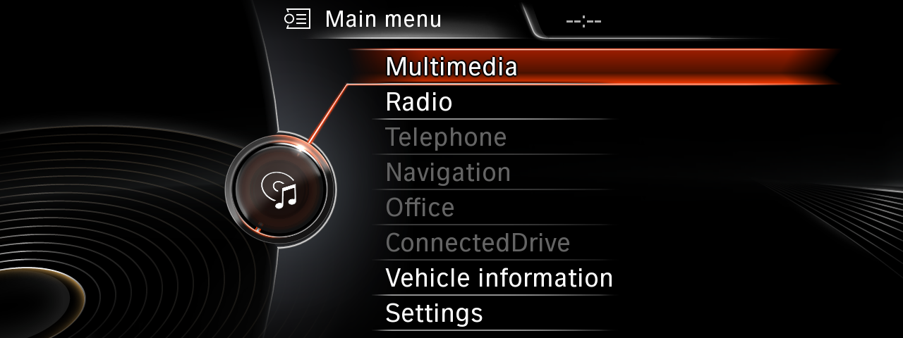
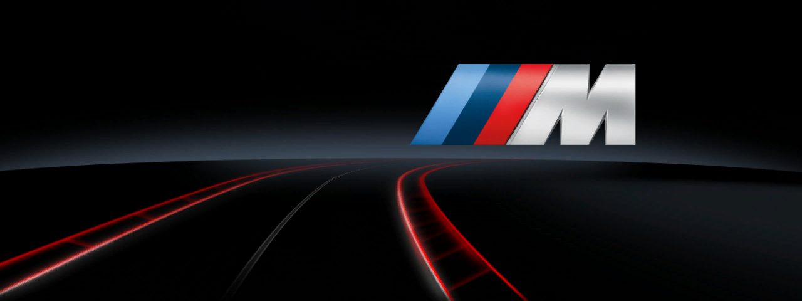

# BMW NBT Emulator

**Freeware | Source-available (PolyForm Strict 1.0.0) | Work in Progress**

An independent project bringing the original BMW NBT iDrive experience to Windows.

## Preview 

A preview of the BMW NBT Emulator interface.





## About

BMW NBT Emulator is a Windows-based project developed to bring the original BMW NBT infotainment experience to personal computers.

Unlike traditional interface recreations, this project aims to run the original BMW NBT software environment, preserving the authentic look, behavior, animations, and functionality of the iDrive system.

Our goal is to create an immersive and interactive BMW infotainment experience for automotive enthusiasts, developers, and simulator builders.

Technically, the original firmware (`HU_NBT 003_009_004`, Intel side: QNX 6.5 x86 with the `HmiMain3D` interface) runs unmodified in QEMU. Its GLES graphics are forwarded to a Windows renderer (ANGLE) through our own bridge.


## What works

- The original QNX kernel and the original `HmiMain3D` interface at 1280×480.
- The main menu and its pages (Settings, Vehicle information, Telephone, Radio, Multimedia…).
- iDrive control from the keyboard or the on-screen buttons: rotate, OK, Back, Menu, tilt, OPTION, RADIO / MEDIA / NAV / TEL. The native key codes come from the firmware.
- The startup animation or splash (M logo, BMW, black screen), chosen from the vehicle coding.
- Smooth menu animations, about 12 ms per active frame with Windows Hypervisor Platform acceleration.

Not working yet: navigation (map engine), telephone, original audio, original Bluetooth, real CAN/MOST, and the Jacinto processor.

## Project Goals

- **Original BMW NBT Experience** — Bring the authentic BMW NBT iDrive interface to Windows.
- **iDrive Controller Support** — Navigate through the system using keyboard controls, virtual inputs, or compatible physical controllers.
- **Vehicle Data Simulation** — Simulate vehicle information, including engine RPM, speed, ignition, gear selection, lighting, and vehicle status.
- **Visual Fidelity** — Preserve the original graphics, animations, transitions, and overall iDrive appearance.
- **Performance and Stability** — Optimize the experience for smooth and reliable operation on Windows.

## Our Vision

We want to make the original BMW NBT experience accessible outside its original automotive environment.

The project is intended for automotive enthusiasts, educational purposes, electronics experimentation, infotainment research, and custom vehicle simulators.

Our long-term vision is to provide a flexible and realistic platform that combines the original BMW infotainment experience with simulated and real-world vehicle data.

## Requirements

- Windows 10/11 x64 with **Windows Hypervisor Platform** enabled (Windows Features → "Windows Hypervisor Platform").
- **Python 3** with Tkinter, through the `py` launcher (from python.org). Tested with Python 3.14.
- A graphics card with Direct3D 11.

QEMU 11.1.0 and ANGLE are included (see `NOTICE.md`).

## Firmware

The emulator expects the firmware-derived files **at exactly these paths**. If any required file is missing, `RUN_NBT.cmd` does not start the VM and shows a window listing the missing files.

| File / folder | What it is | Required |
|---|---|---|
| `work/bridge-v2/ifs/walthread_keyboard_dma_v2_prio.ifs` | emulation IFS image (NBT firmware + the emulator's adapters) | yes |
| `outputs/NBT_emulation_research/btld_00001275/Intel/fs/sda2/appimage.ifs` | original `appimage.ifs`, used by the loader as reference | yes |
| `work/graphics-port/host/shader-cache/` | GLSL shaders recovered from the firmware's shader cache | yes |
| `work/graphics-port/syset-native/hmi_native_coding_schema.json` | coding descriptors from `HmiMain3D` (startup screen) | no |
| `outputs/NBT_files/00001e6b/Intel/fs/sda0/repository/istep/opt/car/data/eva/images/` | EVA startup resources (`eva_splash_*.png`, `eva_ani_*.pdds`) | no |

Without the optional files, the emulator starts without the startup screen. The firmware belongs to BMW AG / Harman / NVIDIA.

## How to run

Double-click:

```
outputs\NBT_live_viewer\RUN_NBT.cmd
```

The first image appears after about 15 s. The keyboard becomes active after about 100 s (message "Tastatura conectata"). On the first start, the startup animation is decoded in the background (about 20 s); from the next start it plays animated.

### Keys

| Key | iDrive action |
|---|---|
| ↑ / ↓, mouse wheel | rotate |
| Enter | OK (push) |
| Esc, Backspace | BACK |
| M, F1 | MENU |
| ← / → | tilt left / right |
| Shift+↑ / Shift+↓ | tilt up / down |
| O | OPTION |
| F2 / F3 / F4 / F5 | RADIO / MEDIA / NAV / TEL |

## Reporting bugs

Open an issue on GitHub ("Issues" → "New issue") with:

1. what you did and what happened (with a screenshot, if possible);
2. your Windows version, Python version and graphics card;
3. the file `work/graphics-port/hmi-runner/viewer-runs/<latest>/verification.json`;
4. from `work/graphics-port/hmi-runner/runs/<latest run>/`: `serial_com1.log` and `relay/renderer-stderr.log`.

## Credits

- **QEMU** — virtual machine emulation (GPL-2.0).
- **ANGLE** — OpenGL ES on top of Direct3D on Windows (BSD-3-Clause).
- **qemu-mhi2** (iscle) — the idea and first prototype of GLES forwarding this project started from. The current bridge is a clean-room reimplementation and contains no qemu-mhi2 code.
- **DoomGeneric** (ozkl) — used in a separate DOOM experiment, not included here.

## Developers

Developed collaboratively by:

- [davisod](https://github.com/DAviS0d)
- [JEtsKi](https://github.com/JEtsKi8271)

## License

Copyright © 2026 davisod & JEtsKi.

The project's own code is licensed under **PolyForm Strict 1.0.0** (`LICENSE`): free for any noncommercial purpose; distribution, modification and derivative works are not permitted. Third-party components keep their own licenses (`NOTICE.md`). The BMW firmware and trademarks are not covered by this license.

## Disclaimer

BMW NBT Emulator is an independent, unofficial enthusiast project and is not affiliated with, sponsored by, or endorsed by BMW AG.

BMW, NBT, iDrive, and related trademarks are the property of their respective owners.

The project does not distribute proprietary BMW firmware or software without the necessary permissions.
